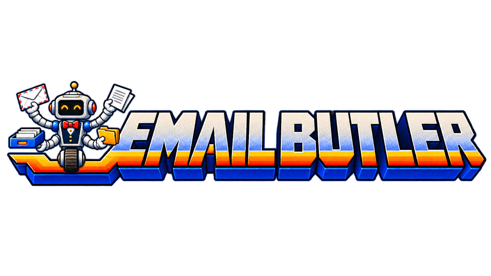

# Email Butler
An email assistant you use by talking to your agent. It helps you review Gmail and Outlook, file recurring mail automatically where supported, and change how it works after showing you a clear preview.

This is an initial prototype. Copy the prompt below into your agent; it will handle installation and set up your Gmail and Outlook connections.

<h2> Start here with your agent</h2>
Copy this prompt into your agent on the computer where you want to use Email Butler:

> Set up Email Butler from the public repository https://github.com/jcklpe/email-butler on this computer. Retrieve the repository, read AGENTS.md, SKILL.md, and references/setup.md, and handle the installation. Install or enable the official Gmail and Outlook/Microsoft 365 connectors for this agent, reusing any correct existing connections. Guide me through sign-in or permission clicks that require me. Check the actual accounts and capabilities available here, create private settings without overwriting existing ones, and show me a small email review using the defaults. Ask customization questions after I have something useful to react to. Keep private settings and mail out of Git. Do not ask me to use a terminal or edit code. If an actual restriction prevents a step, explain that specific restriction and what I need to do next.

The agent handles the technical steps, including setup, saved preferences, updates, and troubleshooting. You describe what you want and approve the result. Your sign-in, consent, and required approval clicks stay with you. If a work-laptop or app restriction blocks setup, deal with that specific restriction when it occurs.

## Everyday use
- “Review my email.”
- “Show me what needs a decision.”
- “Help organize recurring messages.”
- “Change my email butler: make the reviews shorter.”

To change how it works from now on, start with **“change my email butler.”** It will explain what would change and ask “Apply this change?” You can reply “Yes, please” or choose a displayed alternative by saying “the second one.” Other feedback helps with the review you are doing now. You can also ask what changed before, or ask to go back to earlier settings.

Automatic mail rules handle predictable future messages after approval. The butler reviews exceptions and messages needing judgment. Creating a rule for future mail and cleaning up existing mail are separate actions.

## A manageable review
You get 15 emails at a time in text and two or three in voice, with the most important decisions first. Each email has its own heading, linked sender/subject, short explanation, bold arrow recommendation, visible unsubscribe line, and separator. The unsubscribe line links directly to the sender’s actual option and explains its type and likely relevance when available. You can approve individual items, change a recommendation, pause, or ask for the next batch. [Example review](references/review.md#chat-layout).

First-time setup offers a [guided quick sort](references/first-run.md): inspect a few real groups, propose useful folders/labels, and file approved groups before settling into regular reviews. Stars and flags stay with the mail; they guide the proposed destination rather than automatically keeping it in Inbox. You can override any recommendation. Inbox is for current incoming mail, with reviewed work and reference material filed into specific homes.

After the quick sort, an overflowing inbox gets two tracks: keep up with new mail, then work through older mail in small sessions or clearly defined groups. The agent uses mailbox searches and native rules for repetitive cleanup instead of reading thousands of messages into a chat. Nothing is bulk archived just because it is old. [Backlog approach](references/organization.md#an-existing-backlog).

## Remembering and reducing the load
When your agent can save settings, Email Butler remembers your preferences, review progress, confirmed mail actions, and clear feedback about recurring messages. You can ask “What do you remember?” or “What changed?” Your history stays private. You can also ask to undo a settings change, return filed mail to Inbox, forget specific feedback, or change the review format. The agent looks up what is needed and explains any choice or limit; you do not manage files or code.

The agent checks patterns after completed slates and proactively raises at most one worthwhile rule/subscription suggestion per session. You do not need to ask it to look. Repeatedly archiving a newsletter can prompt “Keep receiving this, unsubscribe, or file it automatically?” The agent checks examples and exceptions with you before setting up a narrow filter or rule. It suggests unsubscribing from unwanted subscriptions and handles it through a supported connection when available, or shows the legitimate sender's unsubscribe link. It never treats silence as consent or changes your rules just because it noticed a pattern. Useful mail can still benefit from specific filing; useful feedback prevents an automatic unsubscribe suggestion, not a filing discussion. Planner and cloud-document integrations are outside this release.

## Current limits
What Email Butler can do depends on your current app and mail connections. Your agent checks them and explains any limit when it affects your request, along with the next useful step.

Saved preferences on one computer are not automatically shared with web chats. If your current chat cannot remember a change for next time, it will say so. Signing in or granting account access may still require your own clicks.

Technical setup and maintenance notes — for agents

## Package contents
The repository root is the skill: [SKILL.md](SKILL.md), [references](references/), [scripts](scripts/), and a synthetic default profile in [assets](assets/). All required workflow guidance and helper code ship together. There is no dependency on the author's personal workspace or Agent Hands installation. The setup marker reuses the Agent Hands robot artwork.

For maintainers, Python 3.11+ is sufficient; the runtime uses the standard library. Run `python3 -m unittest discover -s tests -v`. The bundled installer registers the Git checkout for supported local clients without copying the skill or overwriting an existing installation. Live connector onboarding and mailbox writes require acceptance testing in the recipient's environment; offline tests do not establish them.

See [conversation](references/conversation.md) for the recipient interface, [setup](references/setup.md) for agent-operated installation/repair, and [capabilities](references/capabilities.md) for technical checks. Shared cloud/local persistence still needs an adapter; the shipped helper uses local private state.

